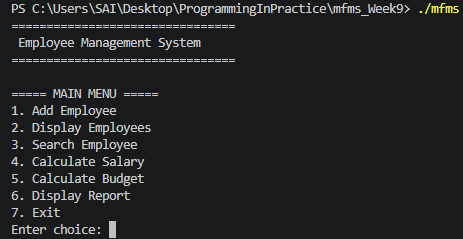
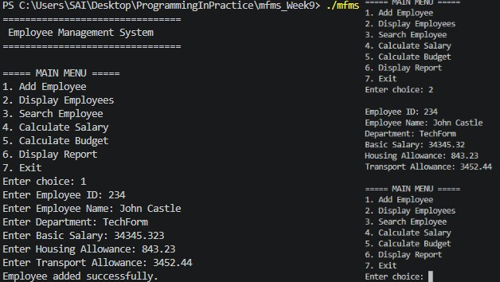
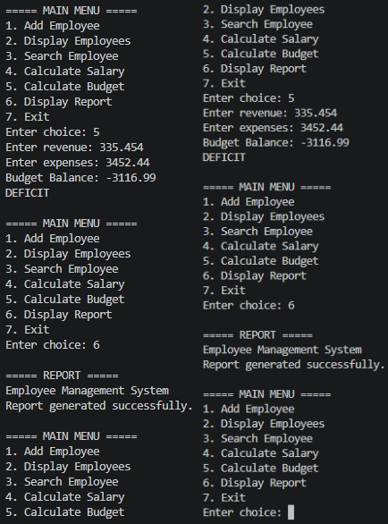

# MFMS - WEEK 9 Laboratory
## Modulae Multi-File Managemnet System

### 1. Project Modules

The MFMS applicationis organized into the folowing modules:

- **main.c** Contains the main function and controls the application menu.
- **employee.c / employees.h:** Handle employee-related operations and provide their function prototypes.
- **budget.c / budget.h:** Handle budget-related operations and provide their 

- **utilities.c / utilities.h:** Contain reusable input and helper functions.
- **reports.c / reports.h:** Handle the generation and display of system reports.

## 2. Compilation and Build Commands

Each source file is compiled separately using GCC with the C99 standard.

```bash
gcc -std=c99 -Wall -Wextra -pedantic -c main.c
gcc -std=c99 -Wall -Wextra -pedantic -c employee.c
gcc -std=c99 -Wall -Wextra -pedantic -c budget.c
gcc -std=c99 -Wall -Wextra -pedantic -c utilities.c
gcc -std=c99 -Wall -Wextra -pedantic -c reports.c
```

Link all object files to create the executable:

```bash
gcc main.o employee.o budget.o utilities.o reports.o -o mfms
```

Run the application:

```bash
./mfms
```

## 3. Testing Evidence

The following screenshots provide evidence of three successful test runs.

### Test 1 – Application Startup and Main Menu

The application starts successfully and displays the main menu.



### Test 2 – Employee Management

An employee management operation was selected to add an employee, display the employee and executed successfully.



### Test 3 – Budget Management and Reports

A budget operation and report was selected and executed successfully.



---

**Result:** The application was successfully compiled, linked and tested without compilation, linker or runtime errors.
